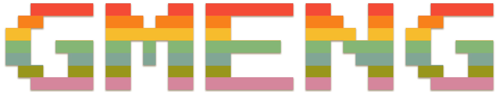

<p align="center">
  
</p>

<h3 align="center">A fast, terminal-based 2D game engine written in C++.</h3>


<p align="center">
  <a href="https://gmeng.org"><b>Documentation</b></a> &nbsp;·&nbsp;
  <a href="https://gmeng.org/changelog">Changelog</a> &nbsp;·&nbsp;
  <a href="WALKTHROUGH.MD">Walkthrough</a> &nbsp;·&nbsp;
  <a href=".github/CONTRIBUTING.md">Contributing</a>
</p>

---

Gmeng draws games in your terminal. It renders in 24-bit color using the [Kitty graphics protocol](https://sw.kovidgoyal.net/kitty/) for pixel-accurate output at any screen size. It also supports ANSI escapecode-based rendering for terminals that do not support the Kitty graphics protocol. Gmeng simultaneously has high-level and easy to use functionality and low-level control of the engine's output at every stage of a game loop. It gives you levels, entities, models and textures, an event loop with keyboard and mouse input, scripting, and an in-game developer toolset, with no engine code to compile alongside your game.

## Features

- **Graphical rendering** Raw framebuffers at any desired resolution, with fully functional input processing.
- **Separate engine build** Compile the engine once, then build and link your games against a single declaration header.
- **Levels, models and entities** Chunked levels, textures, models, animated entities and lighting, with save and load support.
- **Event loop** Hook `INIT`, `UPDATE`, `FIXED_UPDATE`, keyboard and mouse events with plain lambdas.
- **Scripting** Lua scripting for game behavior without recompiling, and [NOBLE](https://github.com/catriverr/noble) shared-library scripts.
- **Developer tools** A developer console, level and script manager, texture editors.
- **Networking** Stream an `EventLoop` over a Gmeng network connection.

## Quick start

Gmeng runs on macOS and Linux. On Windows, use [WSL](https://learn.microsoft.com/en-us/windows/wsl/install). For the best results run your games in [Kitty](https://sw.kovidgoyal.net/kitty/). If a game is launched without explicitly passing the argument `--profile`, Gmeng will launch its own window running Kitty.

```sh
git clone https://github.com/catriverr/gmeng-sdk
cd gmeng-sdk
make setup            # fetches submodules and installs required libraries
make compile-engine   # builds the engine once into gmeng_engine.o
```

Build any game against the compiled engine:

```sh
make with-engine filename=game.cpp
./game
```

See the [getting started guide](https://gmeng.org) for requirements, platform notes and build options.

## Examples

### A window-sized world you can scroll

```cpp
#define GMENG_EASY
#include "lib/gmeng.h"

using namespace Gmeng;
using namespace Gmeng::Util;

int main(int argc, char** argv) {
    patch_argv_global(argc, argv);

    static Level level;
    static EventLoop ev;
    ev.level = &level;
    // set the FPS for FIXED_UPDATE events
    ev.level->display.fixed_update_fps = 120;

    ev.add_hook({ INIT }, [](Level* lv, EventInfo*) {
        // get the available space of the window
        auto [w, h] = kitty_get_terminal_size_in_pixels();

        texture bg;
        // create a texture with a size twice the screen
        bg.reserve(w*2, h*2);
        for (uint32_t i = 0; i < bg.size(); i++)
            bg[i] = { (i / (h*2)) % 2 == 0 ? RED : BLACK };
        // a cascading red and black background image
        // twice the size of the available space
        lv->base.set(bg);
        // the camera only views a quarter of the image
        lv->display.viewpoint = { { 0, 0 }, { w, h } };
        lv->display.camera.modifiers.sort();
        // hide the terminal cursor
        lv->display.set_cursor_visibility(false);
    });

    ev.add_hook({ UPDATE }, [](Level* lv, EventInfo*) {
        // engine-provided frame display function
        lv->display.refresh(lv);
    });

    ev.add_hook({ FIXED_UPDATE }, [](Level* lv, EventInfo*) {
        // basic movement controls with WASD, moving the
        // viewpoint of the screen, scrolling the background.

        if (getkey(gk_W)) lv->display.move_viewpoint_by( 0, -4);
        if (getkey(gk_S)) lv->display.move_viewpoint_by( 0,  4);
        if (getkey(gk_A)) lv->display.move_viewpoint_by(-4,  0);
        if (getkey(gk_D)) lv->display.move_viewpoint_by( 4,  0);
    });

    ev.add_hook({ KEYPRESS }, [](Level* lv, EventInfo* info) {
        // static keypress listener for the 'q' button
        // which cancels the event loop and quits the game
        if (info->KEYPRESS_CODE == 'q') ev.cancel();    
    });

    ev.add_hook({ MOUSE_SCROLL_UP, MOUSE_SCROLL_DOWN }, [](Level* lv, EventInfo* info) {
        // also enable scrolling the background with the mouse / trackpad
        if ( info->EVENT == MOUSE_SCROLL_UP ) {
            lv->display.move_viewpoint_by(0, -4);
        } else {
            lv->display.move_viewpoint_by(0, 4);
        };
    });

    // launch the game
    do_event_loop(&ev);
    // re-enable cursor visibility after exit
    level.display.set_cursor_visibility(true);
    return 0;
};
```

Move with `W` `A` `S` `D` and quit with `q`. Alternatively use the mouse/trackpad to scroll.

### Draw text over the frame

Anything drawn through the camera appears on top of the world. Add this to the `UPDATE` hook, before `refresh`, to show the frame rate:

```cpp
auto& cam = lv->display.camera;
cam.add_text({ 10, 10 }, "FPS: " + v_str(1000.0f / cam.draw_time), RED);
```

`large_level.cc` in this repository is a complete, larger example with a loaded level, animated entities, pixel-accurate mouse input and post-processing.

## Documentation

The full documentation, including the API reference for every function, type and class, guides for each separate version of the engine, is available at **[gmeng.org](https://gmeng.org)**.

## What's new

**Gmeng 14.2.0** (November 2026)

- The engine now compiles separately. Build it once with `make compile-engine`, then link your game with `make with-engine`.
- New public header `lib/gmeng.h` declares everything the engine exposes. `lib/bin/easy.h` now includes only declarations.
- New engine functions and entity-editor extensions, including `Blob::get_resized`, `GMENG_ENTITY` and `GMENG_ENTITYID`.
- Examples and games are expected to target the Kitty graphics renderer.

**Gmeng 14.0.0**: ImGui integration, scripting, performance improvements and console improvements.

See the full history in [`CHANGELOG.md`](CHANGELOG.md) or on [gmeng.org/changelog](https://gmeng.org/changelog).

## Contributing

Contributions are welcome. Please read [`CONTRIBUTING.md`](.github/CONTRIBUTING.md) and the [code of conduct](.github/CODE_OF_CONDUCT.md) first. To report a security issue, see [`SECURITY.md`](SECURITY.md).

## License

Gmeng is released under a zlib-style license. See [`LICENSE`](LICENSE).

## Credits

Gmeng is written and maintained by [catriverr](https://github.com/catriverr). It builds on [liblmf](https://github.com/catriverr/liblmf), [NOBLE](https://github.com/catriverr/noble), [Dear ImGui](https://github.com/ocornut/imgui), [sol2](https://github.com/ThePHD/sol2) and [ImGuiColorTextEdit](https://github.com/BalazsJako/ImGuiColorTextEdit).
